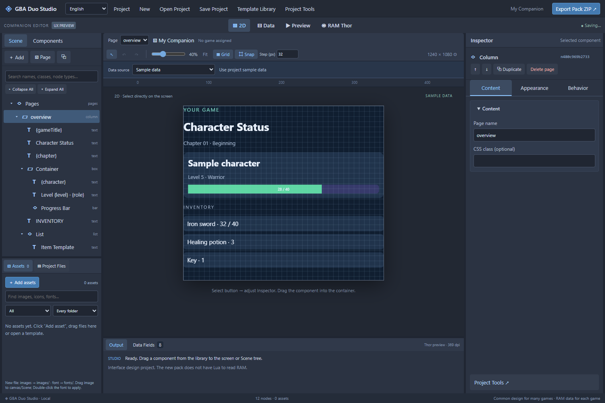

# GBA Duo Studio

A local visual editor for companion interfaces: build a scene, edit properties, preview sample or live data, and export a companion ZIP.

Maintained by [levi-soft](https://github.com/levi-soft). Studio creates packs for [GBA Duo by khumam](https://github.com/khumam/gba-duo); thank you to its author and contributors for the original companion format and emulator. Studio is a separate community authoring tool, not the official emulator or simulator.

[Hướng dẫn tiếng Việt](README.vi.md) · Development beta **0.3.0-beta.1** · Community project, not an official GBA Duo release.



## Start

Clone the repository and enter its directory:

```sh
git clone https://github.com/levi-soft/gba-duo-studio.git
cd gba-duo-studio
```

Use `Run-Studio.bat`, or run `npm ci` followed by `npm run dev -- --host 127.0.0.1`. Node.js 22.17 or newer is required. Keep the server bound to your own computer.

Open the local address printed by Vite (normally `http://127.0.0.1:5173`). Windows users can close the launcher-managed server with `Stop-Studio.bat`; in a terminal, press Ctrl+C. Internet is needed for the initial dependency installation; sample-data design does not require a connected handheld.

Read the complete user guide in [English](docs/USER-GUIDE.md) or [Tiếng Việt](docs/USER-GUIDE.vi.md).

The interface defaults to English. Select **Tiếng Việt** in the top menu to switch; the browser remembers your choice. New project templates follow that choice, while existing project text stays unchanged.

## Tools

- Scene hierarchy, component palette, drag/drop, Inspector, assets, undo and redo.
- Custom canvas dimensions, visual styles, bindings, conditional classes and navigation.
- Project save/load and companion ZIP import/export, preserving Lua and binary assets.
- Three neutral starter templates without ROM content.
- Project Tools for direct/pointer RAM fields, signed/unsigned values, masks, shifts and pulse configuration.
- Import, edit and select a custom Lua entry script for game-specific logic.
- ADB-connected read-only memory tools for compatible emulator builds. In [GBA Duo Plus 0.1.6](https://github.com/levi-soft/gba-duo-plus/releases/tag/plus-v0.1.6), enable **Studio Connection** from the game's quick menu before connecting.

The preview does not execute ROMs or Lua. Validate generated companions on the target device. Hardware input/control features depend on emulator support; exporting a layout does not require a particular fork.

Studio does not automatically discover a game's memory layout or implement its rules. Creators supply the addresses and, when needed, Lua logic. See [the complete authoring workflow](docs/AUTHORING.md).

English is the default documentation and interface language. [README tiếng Việt](README.vi.md) and the [Vietnamese user guide](docs/USER-GUIDE.vi.md) cover the same installation and authoring workflow.

## Development

```sh
npm run verify
npm run source:zip
```

Verification runs strict type checks, source-boundary checks, tests and a production build. The source ZIP is written to `.studio-runtime/distribution/` and excludes private projects, device captures, Git history and installed dependencies. CI is configured for Windows and Linux with Node 22 and 24; it has not run on GitHub until this source is pushed. Local browser/device results are recorded separately from CI.

The active preview implementation is in `src/lib/preview/`. See [workspace boundaries and Inspector organization](docs/WORKSPACE.md).

## License and attribution

GPL-3.0-only; see [LICENSE](LICENSE) and [NOTICE.md](NOTICE.md). The compatible baseline CSS includes adaptations from GBA Duo under its GPL license. Third-party dependency notices are in [THIRD-PARTY-NOTICES.txt](THIRD-PARTY-NOTICES.txt). Studio's license does not change the rights to companion assets or scripts.

Private projects, game adapters/assets, releases and historical archives are outside this source distribution. Review [SECURITY.md](SECURITY.md) before using live memory tools and [CONTRIBUTING.md](CONTRIBUTING.md) before submitting changes.
